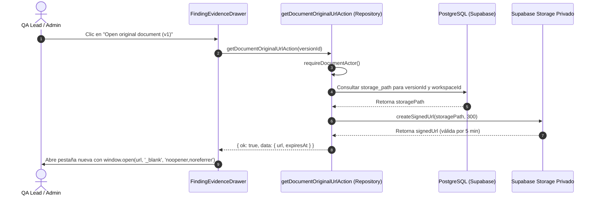

# Diseño Técnico: S2-10 — Lista de Hallazgos y Detalle Seguro de Evidencia

- **Fecha:** 2026-10-27
- **Ticket:** S2-10 ([SAA-22](https://linear.app/saasprojectkdm/issue/SAA-22/lista-de-hallazgos-y-detalle-seguro-de-evidencia))
- **Responsable:** Juan Pablo Castaño Arango
- **Estado:** Aprobado para Planificación de Implementación
- **Referencias:** PRD §§20–23, 36, 46–48, 66; ADR-001; Protocolo del Día Cero; Tickets S2-08, S2-09

---

## 1. Contexto y Objetivo

En el Sprint 2 (AI Analysis v0.2), el sistema procesa documentación interna cargada para detectar contradicciones y obsolescencia. Mientras que S2-08 finalizó la persistencia atómica de hallazgos y S2-09 entregó la confirmación de análisis, monitoreo de estados y reintento con liberación de créditos, **S2-10 entrega la experiencia de usuario para la inspección y consulta de hallazgos y evidencia**.

La historia de usuario establece:
> **Como** QA Lead  
> **Quiero** consultar hallazgos ordenados y sus fragmentos de evidencia  
> **Para** evaluar la propuesta de la IA frente a las versiones que realmente fueron analizadas.

### Principios Fundamentales del Producto
1. **La IA propone, la evidencia demuestra y las personas deciden:** En S2, los hallazgos se presentan en un estado de inspección humana (`pending_review`, `unassigned`). Las mutaciones de flujo de trabajo (confirmar, marcar falso positivo, asignar, resolver) quedan estrictamente reservadas para el Sprint 3.
2. **Vertical Revisable:** Una lista de títulos aislados no satisface el valor del incremento; el usuario debe poder inspeccionar fragmentos de texto exactos lado a lado (*side-by-side*) y abrir los archivos originales de las versiones específicas analizadas.
3. **Frontera Interna de `confidence`:** La métrica `confidence` es una puntuación interna (0.0–1.0) utilizada exclusivamente para evaluación algorítmica. Jamás se expone en la UI, el DOM, los DTOs públicos, las respuestas de red ni en los filtros.

---

## 2. Decisiones de Arquitectura y Enfoque Seleccionado

Se adopta un **Modelo Híbrido en Next.js App Router con URL Search Params y Panel Lateral Deslizable (Drawer)**:

1. **Punto de Entrada y Ruta:**
   - Desde `/analysis/[analysisId]` (S2-09), una vez que el análisis alcanza el estado terminal `completed`, se despliega una acción destacada que dirige al usuario a `/analysis/[analysisId]/findings`.
   - La página de hallazgos conserva `analysisId` en la ruta, ofreciendo navegación de retorno clara (*breadcrumbs*) hacia el estado general del análisis.
2. **URL Search Params como Fuente de Verdad del Estado:**
   - Los criterios de filtrado (`type`, `severity`, `status`, `assignee`) y la paginación (`page`) residen en los parámetros de búsqueda de la URL (`/analysis/[analysisId]/findings?severity=High&page=1`).
   - El hallazgo activo en inspección se sincroniza mediante `?findingId=<uuid>`.
   - Esto permite enlaces compartibles entre miembros autorizados del equipo, compatibilidad con los botones "Atrás/Adelante" del navegador y persistencia de filtros al recargar.
3. **Drawer Deslizable para Evidencia:**
   - Al pulsar "View Evidence" en un hallazgo, se despliega un panel lateral derecho (Drawer) sin perder la posición de scroll ni los filtros aplicados en la lista.
   - En hallazgos de contradicción con dos fragmentos de evidencia, la información se renderiza en dos columnas comparativas paralelas en desktop (*side-by-side*) y de forma apilada en pantallas móviles.
4. **Integración con el Módulo Repository para Originales:**
   - La apertura de archivos originales reutiliza la API pública autorizada `getDocumentOriginalUrlAction(versionId)` del módulo `@/modules/repository`.
   - El cliente jamás envía buckets o rutas de almacenamiento; el servidor resuelve la ruta física autorizada para el `versionId` exacto almacenado en la evidencia y genera una URL firmada de 300 segundos de duración.

---

## 3. Invariantes de Seguridad y Límites de Privacidad

| Invariante | Mecanismo de Implementación |
|---|---|
| **Aislamiento de Tenant y RBAC** | Cada Server Action valida la identidad mediante `requireDocumentActor()`. El acceso queda reservado exclusivamente para `Admin` y `QA Lead` del workspace. El rol `Member` es rechazado con `FORBIDDEN`. Consultas cross-tenant son bloqueadas tanto por RLS como en el servidor. |
| **Filtro por Estado del Análisis** | Los hallazgos solo pueden consultarse si `analyses.status = 'completed'` y `analyses.workspace_id = current_workspace_id()`. Análisis inexistentes, no completados o de otro workspace retornan un error controlado `NOT_FOUND`. |
| **Protección Interna de `confidence`** | La columna `confidence` en `findings` no tiene `GRANT SELECT` concedido a `authenticated`. Las interfaces públicas de TypeScript (`FindingSummary`, `FindingDetail`) y los esquemas Zod omiten `confidence`. Las pruebas unitarias comprueban su ausencia estricta en las cargas útiles de red. |
| **Aislamiento de Datos Crudos de IA** | Respuestas crudas del LLM, prompts del sistema, huellas (*fingerprints*) y vectores semánticos se mantienen en el servidor y nunca se exponen al cliente. |
| **Defensa contra XSS en Textos de Documentos** | Los fragmentos textuales (`snapshot`) y explicaciones extraídas de documentos se tratan como texto no confiable. Se renderizan exclusivamente como nodos de texto nativos de React (`<p className="whitespace-pre-wrap font-mono">`). Queda prohibido el uso de `dangerouslySetInnerHTML`. |
| **Vinculación a la Versión Exacta Analizada** | Las evidencias apuntan al identificador de versión exacto analizado. Si posteriormente existe o se activa una nueva versión del documento, el visor de evidencia abre inequívocamente la versión analizada, sin sustituir por `documents.active_version_id`. |
| **Observabilidad Segura** | El registro de fallos con `captureOperationFailure` incluye únicamente operación, código y correlation ID. Fragmentos de documentos, nombres sensibles, prompts y URLs firmadas nunca se envían a Sentry ni a logs. |
| **Sin Mutaciones de Flujo en S2** | La interfaz omite botones de Confirmar, Falso Positivo, Asignar o Resolver. Todos los hallazgos en S2 muestran estado `pending_review` y asignatario `Unassigned`. |

---

## 4. Especificación de Contratos e Interfaces

### 4.1 Contratos TypeScript (`src/types/contracts.ts`)

```typescript
export type FindingType = "contradiction" | "obsolescence";
export type FindingSeverity = "High" | "Medium" | "Low";
export type FindingStatus = "pending_review";

export interface FindingSummary {
  id: string;
  analysisId: string;
  type: FindingType;
  explanation: string;
  severityOriginal: FindingSeverity;
  severityCurrent: FindingSeverity;
  status: FindingStatus;
  assignee: EligibleOwner | null; // Siempre null en S2 ("Unassigned")
  createdAt: string;
}

export interface FindingEvidenceItem {
  id: string;
  documentId: string;
  documentName: string;
  versionId: string;
  versionNumber: number;
  chunkId: string;
  pageNumber: number | null;
  section: string | null;
  sectionHeading: string | null;
  snapshot: string; // Máximo 2,000 caracteres
}

export interface FindingDetail extends FindingSummary {
  evidence: FindingEvidenceItem[];
}

export interface FindingsQuery {
  analysisId: string;
  type?: FindingType;
  severity?: FindingSeverity;
  status?: FindingStatus;
  assignee?: "all" | "unassigned";
  page?: number;     // Predeterminado: 1
  pageSize?: number; // Predeterminado: 10, Máximo: 50
}

export interface AnalysisResultsApi {
  listFindings(query: FindingsQuery): Promise<ActionResult<AnalysisPage<FindingSummary>>>;
  getFinding(findingId: string): Promise<ActionResult<FindingDetail>>;
}
```

### 4.2 Esquemas Zod (`src/modules/analysis/schemas.ts`)

```typescript
export const findingsQuerySchema = z.object({
  analysisId: z.string().uuid(),
  type: z.enum(["contradiction", "obsolescence"]).optional(),
  severity: z.enum(["High", "Medium", "Low"]).optional(),
  status: z.literal("pending_review").optional(),
  assignee: z.enum(["all", "unassigned"]).optional(),
  page: z.coerce.number().int().min(1).default(1),
  pageSize: z.coerce.number().int().min(1).max(50).default(10),
});

export const findingIdSchema = z.string().uuid();
```

---

## 5. Capa de Aplicación y Consultas

### 5.1 Server Actions (`src/modules/analysis/application/analysis.actions.ts`)

1. `listFindingsAction(query: FindingsQuery): Promise<ActionResult<AnalysisPage<FindingSummary>>>`
   - Revalida al actor mediante `requireDocumentActor()`.
   - Valida los parámetros de entrada usando `findingsQuerySchema`.
   - Consulta `analysis_runs` para verificar que el análisis exista, pertenezca al workspace del actor y tenga `status = 'completed'`.
   - Consulta la vista `analysis_findings`:
     - Aplica filtros para `type`, `severity_current` y `status`.
     - Ordena por severidad: `High` (1) → `Medium` (2) → `Low` (3).
     - Desempate determinista: `created_at DESC, id DESC`.
     - Aplica paginación mediante `.range(offset, offset + pageSize - 1)`.
   - Mapea las filas al DTO `FindingSummary[]` (asegurando `assignee: null`).
   - Retorna `{ ok: true, data: { items, total, page, pageSize } }`.

2. `getFindingDetailAction(findingId: string): Promise<ActionResult<FindingDetail>>`
   - Revalida al actor mediante `requireDocumentActor()`.
   - Valida el formato UUID con `findingIdSchema`.
   - Obtiene el registro del hallazgo desde `analysis_findings` para el workspace del actor.
   - Obtiene los registros de evidencia desde `analysis_finding_evidence`, vinculando con `documents(name)` y `document_versions(version_number)`.
   - Ensambla y retorna el DTO `FindingDetail`.

---

## 6. Arquitectura de Interfaz y Componentes

### 6.1 Estructura de Rutas
- **Ruta:** `src/app/(workspace)/analysis/[analysisId]/findings/page.tsx`
- **Tipo:** Server Component con parámetros dinámicos `params: Promise<{ analysisId: string }>` y `searchParams: Promise<Record<string, string | string[] | undefined>>`.
- **Comportamiento:** Procesa los search params, ejecuta la carga inicial con `listFindingsAction` (y `getFindingDetailAction` si `findingId` está presente) y renderiza `FindingsView`.

### 6.2 Jerarquía de Componentes
```
src/app/(workspace)/analysis/[analysisId]/findings/page.tsx
└── FindingsView (Client Component)
    ├── BreadcrumbHeader ("Back to Analysis Overview")
    ├── FindingsFilterBar
    │   ├── TypeSelect (All, Contradiction, Obsolescence)
    │   ├── SeveritySelect (All, High, Medium, Low)
    │   ├── StatusSelect (All, Pending Review)
    │   ├── AssigneeSelect (All, Unassigned)
    │   └── ClearFiltersButton
    ├── FindingsTable / FindingsList
    │   ├── FindingRow / Card
    │   │   ├── SeverityBadge (High: Rojo, Medium: Ámbar, Low: Azul)
    │   │   ├── TypeBadge
    │   │   ├── ExplanationSummary
    │   │   ├── StatusBadge ("Pending Review")
    │   │   └── ViewEvidenceButton
    ├── PaginationFooter ("Page X of Y", botones Prev / Next)
    ├── EmptyStateDisplay (Diferenciado: 0 hallazgos vs 0 coincidencias de filtros)
    └── FindingEvidenceDrawer (Panel Deslizable Lateral)
        ├── DrawerHeader (Badges de Tipo/Severidad y botón de cierre ✕)
        ├── FullExplanation
        └── EvidenceComparisonGrid
            ├── ContradictionSideBySide (2 columnas en lg, 1 en móvil)
            │   ├── EvidenceCard A (Nombre doc, vX, Ubicación, Snapshot, Botón Abrir)
            │   └── EvidenceCard B (Nombre doc, vY, Ubicación, Snapshot, Botón Abrir)
            └── ObsolescenceSingleCard (Ancho completo)
```

### 6.3 Flujo de Apertura Segura de Documentos Originales


---

## 7. Manejo de Errores y Observabilidad

| Escenario | Respuesta en UI | Telemetría Interna |
|---|---|---|
| Usuario no autenticado | Redirección a `/login` | Ninguna |
| Rol `Member` | `403 Forbidden` OperationError ("Only Admins and QA Leads can view findings.") | `captureOperationFailure` (código: FORBIDDEN) |
| Análisis no encontrado o de otro tenant | `404 Not Found` OperationError ("This analysis is unavailable.") | `captureOperationFailure` (código: NOT_FOUND) |
| Análisis en procesamiento o fallido | Alerta controlada ("Findings are only available once the analysis is completed.") | Ninguna (estado esperado) |
| Hallazgo no encontrado en Drawer | Alerta interna en Drawer ("The requested finding is unavailable.") | `captureOperationFailure` (código: NOT_FOUND) |
| Error inesperado del backend | Mensaje controlado ("We couldn't load findings. Please try again.") con correlation ID | `captureOperationFailure` (código: INTERNAL_ERROR, correlationId) |

---

## 8. Estrategia de Pruebas Automatizadas

### 8.1 Pruebas Unitarias y de Integración con Vitest
1. **Ordenamiento y Desempate:** Poblar hallazgos con severidades mixtas (Low, High, Medium); asegurar que el orden retornado sea High → Medium → Low, con desempate determinista por `createdAt DESC, id DESC`.
2. **Filtrado Correcto:** Probar combinaciones de filtros (`type=contradiction`, `severity=High`, `status=pending_review`).
3. **Paginación Matemática:** Probar páginas límite, páginas vacías y acotación máxima de `pageSize` a 50.
4. **Ausencia de `confidence`:** Verificar rigurosamente que ningún objeto retornado contenga la propiedad `confidence` (`expect("confidence" in item).toBe(false)`).
5. **Inmunidad ante XSS:** Pasar fragmentos con scripts maliciosos (`<script>alert(1)</script>`, ``); comprobar que se renderizan como texto plano sin ejecución en el DOM.
6. **Comparación Lado a Lado:** Verificar que un hallazgo de contradicción con dos evidencias monte dos columnas comparativas con sus respectivos nombres y números de versión.

### 8.2 Pruebas SQL y RLS en Supabase (`supabase/tests/database/`)
1. **Aislamiento Cross-Tenant:** Verificar que el Workspace A no pueda leer registros de `analysis_findings` ni de `analysis_finding_evidence` pertenecientes al Workspace B.
2. **Restricción para Rol Member:** Verificar que un usuario con rol `Member` obtenga 0 filas al intentar consultar hallazgos.
3. **Condición de Análisis Completado:** Verificar que hallazgos asociados a análisis en `queued`, `processing` o `failed` no sean accesibles mediante la vista.
4. **Denegación de Columna `confidence`:** Verificar que `SELECT confidence FROM findings` genere un error de permisos para el rol `authenticated`.

### 8.3 Validación de Flujo Completo
- Verificar la transición desde el estado `completed` en `/analysis/[analysisId]` hacia `/analysis/[analysisId]/findings`.
- Verificar que el botón "Open original document" invoque la generación de URL firmada de 300 segundos para la versión analizada exacta.
